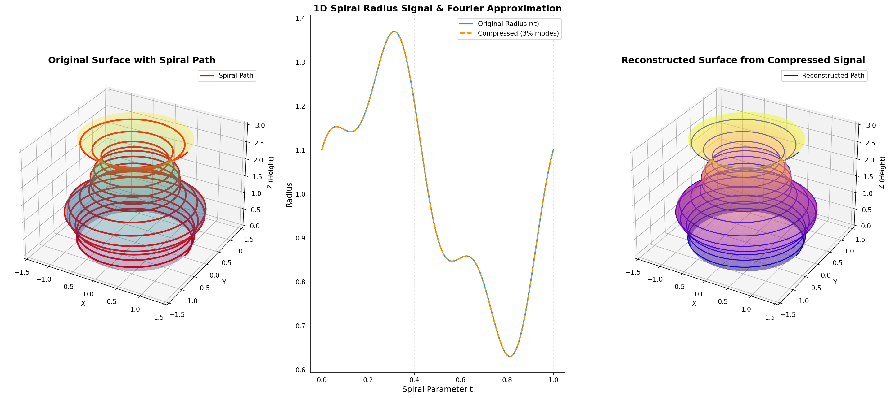
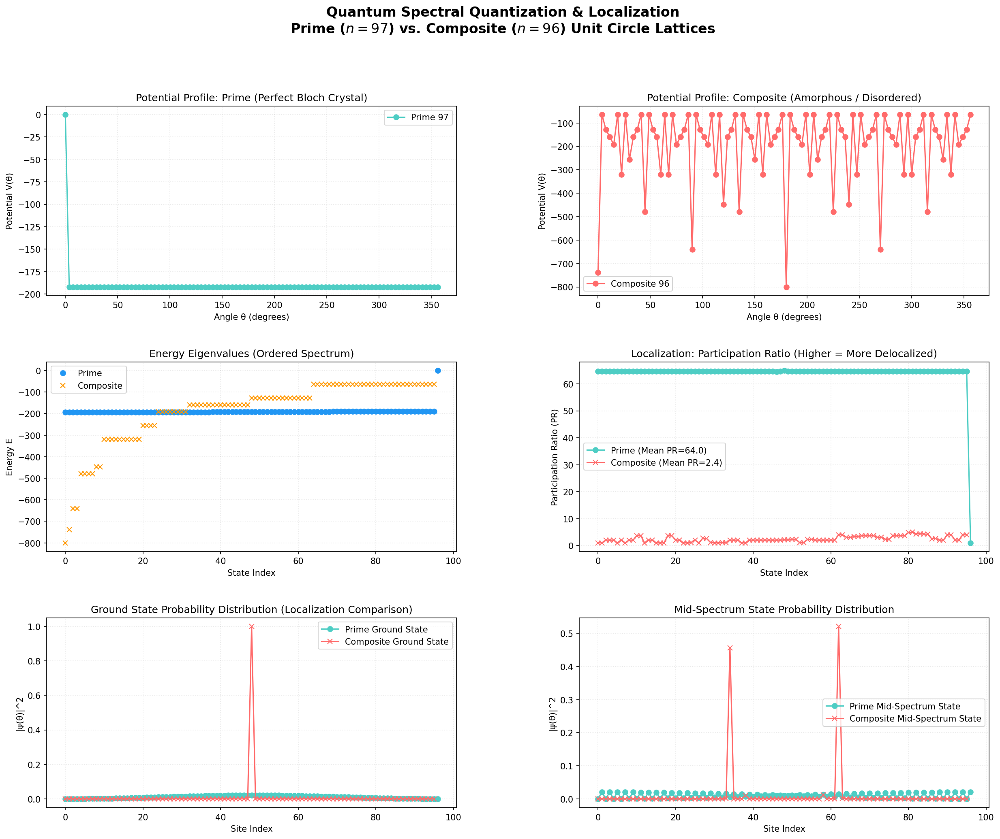
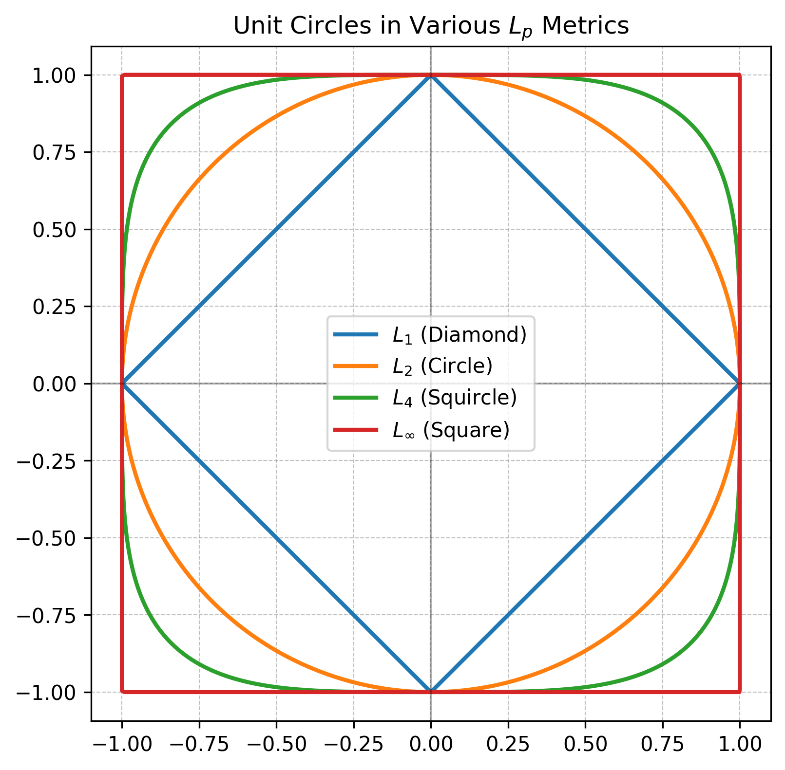
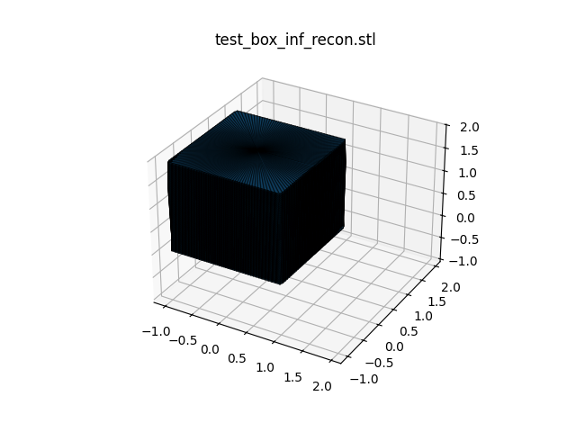
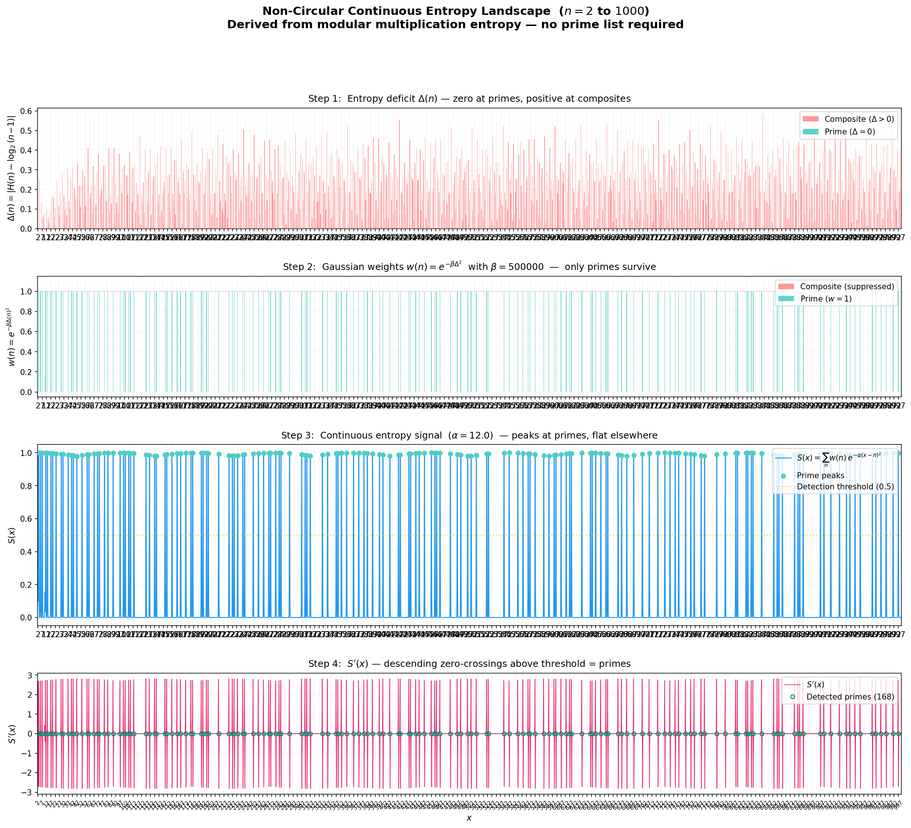

# PaddyMathPapers 🔬📐

[](https://www.python.org/downloads/)
[](https://www.tug.org/texlive/)
[](docs/author_context.md)
[](docs/provenance.md)
[](LICENSE)

An open computational mathematics laboratory exploring the boundaries between **differential geometry**, **Lie group frame parameterization**, **algebraic information theory**, and **quantum transport analogues** through human-directed, AI-collaborative inquiry.

---

## ⚡ Quick Links & Pre-Compiled Manuscripts

| Manuscript | Focus Areas | Formats |
| :--- | :--- | :---: |
| **Spectral Compression of 3D Surfaces via Quaternionic Moving Frames and the Spiral Transform** | Differential geometry, Bishop/Frenet moving frames, unit quaternions in $\mathbb{H}$, $\operatorname{SU}(2)$ spin operators, infinite-winding spiral dimensional reduction ($3\text{D} \to 1\text{D}$), Minkowski $L_p$ spaces, dynamic metric variance optimization. | [**[PDF]**](pdf/spectral_compression_3d_surfaces.pdf) &bull; [**[LaTeX]**](spectral-compression/main.tex) |
| **On the Spectral Entropy, Periodicity, and Representation Limits of Discrete Sequences** | Finite field entropy maximization, the Spectral Remainder Transform $\mathcal{S}_n(z)$, Laurent series & Ramanujan sums, quantum ring tight-binding simulation & Anderson localization, $\mathcal{O}(N\log N)$ FFT periodicity, Information Conservation Law ($M \cdot B \ge N$). | [**[PDF]**](pdf/spectral_entropy_discrete_sequences.pdf) &bull; [**[LaTeX]**](spectral-entropy/main.tex) |
| **The Open Research Notebook & Design Archive** | Author context, initial peer critiques, mathematical resolutions, engineering blueprints, and future publication milestones. | [**[Browse Notebook]**](docs/README.md) |

---

## 🖼️ Visual Showcase Gallery

### 1. 3D Surface Spectral Compression & Spiral Reduction
By taking the winding number of a moving-frame spiral around a 3D curved axis to infinity, we execute a continuous dimensional reduction from a 2D surface manifold to a single 1D radius waveform $r(t)$. Because physical surfaces exhibit strong spatial correlation, their 1D radius signals are spectrally concentrated, enabling high-fidelity geometric reconstruction while discarding **$97\%$ of Fourier modes**:

<p align="center">
  
</p>
<p align="center"><em>Left: Original 3D vase with winding helical path. Middle: Extracted 1D radius signal $r(t)$ and compressed 3% Fourier reconstruction. Right: Lossless 3D geometric surface recovery.</em></p>

---

### 2. Number-Theoretic Anderson Localization in Quantum Rings
Translating modular multiplication tables into Dirac delta-potential wells on a 1D unit ring reveals a striking physical phenomenon: prime moduli form uniform finite fields that permit free-flowing, extended Bloch waves, while composite moduli produce disordered zero-divisor sinks that shatter the band structure and trigger severe **Anderson localization**:

<p align="center">
  
</p>
<p align="center"><em>Numerical tight-binding simulation for prime $n=97$ vs. composite $n=96$. Top: Potential profiles $V(\theta)$. Middle: Ordered energy spectra and Participation Ratios (PR). Bottom: Spatial eigenstates demonstrating extended transport in primes ($\text{PR} \approx 66\%$) versus complete wavefunction localization in composites ($\text{PR} \approx 2.5\%$).</em></p>

---

### 3. Non-Euclidean $L_p$ Metric Spaces & Sharp Geometries
Standard Fourier methods suffer from severe Gibbs ringing at sharp corners. By generalizing the sampling manifold to Minkowski $L_p$ metric spaces with $p$-generalized trigonometry ($\cos_p, \sin_p$), we prove that minimizing spatial variance ($\operatorname{Var}(r) = \sum |\hat{r}[k]|^2$) auto-selects the optimal metric (e.g., $L_\infty$ for boxes), flattening corners into a low-frequency signal that Fourier analysis compresses flawlessly:

<p align="center">
  
  
</p>
<p align="center"><em>Left: Unit circles in Minkowski $L_p$ spaces ($p=1$ diamond, $p=2$ Euclidean, $p=\infty$ square). Right: Sharp 3D box mesh flawlessly decompressed using only 5% of Fourier modes under variance-optimized $L_\infty$ sampling.</em></p>

---

### 4. Continuous Entropy Landscapes & Prime Gradient Search
By evaluating modular multiplication tables from first principles, we construct a smooth, differentiable continuous entropy signal $S(x)$ whose peaks correspond to primes. The descending zero-crossings of the derivative $S'(x)$ isolate primes via momentum-augmented gradient ascent with zero false positives:

<p align="center">
  
</p>
<p align="center"><em>Continuous entropy landscape $S(x)$ through $x = 1000$. Primes emerge naturally as the unique integers whose modular multiplication tables achieve maximum Shannon entropy.</em></p>

---

## 📚 The Research Manuscripts

### Paper 1: Spectral Compression of 3D Surfaces via Quaternionic Moving Frames and the Spiral Transform
* **Path:** [`spectral-compression/`](spectral-compression/) &bull; **PDF:** [`pdf/spectral_compression_3d_surfaces.pdf`](pdf/spectral_compression_3d_surfaces.pdf)
* **Abstract:** We present a differential-geometric framework for the spectral compression of three-dimensional surfaces of revolution about non-planar curved axes. The rotation field is governed by moving frames (Bishop/Frenet-Serret) and unit quaternions in $\mathbb{H}$, connecting geometric construction to the $\operatorname{SU}(2)$ spin operators of quantum mechanics. By taking the winding number to infinity, we execute a spiral dimensional reduction mapping the 3D surface onto a single continuous 1D radius signal $r(t)$. We prove that concave boundary curves naturally develop cusp singularities when the offset approaches the axis radius of curvature. Furthermore, we expand the framework from Euclidean $L_2$ spaces to Minkowski $L_p$ spaces, proving that spatial variance minimization auto-selects optimal metrics for sharp CAD geometries.
* **Key Findings:**
  - **Tubular Diffeomorphism (Proposition 1):** $\det J = 1 - u\kappa(s) > 0 \iff \max r(s) < \min 1/\kappa(s)$.
  - **Cusp Singularity Analysis:** Vanishing of $h'(s) = \mathbf{T}(s)(1 - r(s)\kappa(s))$ marks the physical boundary of the tubular neighborhood.
  - **Spiral Density (Proposition 2):** In the limit $n \to \infty$, the image of the spiral path $\mathbf{c}_n(t)$ is dense in the surface $\mathcal{M}$.
  - **Variance Minimization (Theorem 1):** $\operatorname{Var}(r) = \sum_{k=1}^{N-1} |\hat{r}[k]|^2$, enabling closed-form metric optimization without FFT evaluation.

---

### Paper 2: On the Spectral Entropy, Periodicity, and Representation Limits of Discrete Sequences
* **Path:** [`spectral-entropy/`](spectral-entropy/) &bull; **PDF:** [`pdf/spectral_entropy_discrete_sequences.pdf`](pdf/spectral_entropy_discrete_sequences.pdf)
* **Abstract:** We establish a unified framework governing the spectral entropy, periodicity, and representation limits of discrete sequences across modular arithmetic, binary strings, and continuous embeddings. First, we prove that the Shannon entropy of flattened modular multiplication matrices achieves its maximum if and only if $n$ is prime. We introduce the Spectral Remainder Transform $\mathcal{S}_n(z)$, a meromorphic function on the unit circle whose Cauchy residues recover remainder distributions, and derive its Laurent series expansion linked to Ramanujan sums. Second, we generalize this to arbitrary binary sequences, demonstrating that per-bit block entropy reaches a minimum at the fundamental period, detectable in $\mathcal{O}(N\log N)$ time via the Fast Fourier Transform. Third, we establish fundamental limits of continuous embeddings, proving an Information Conservation Law ($M \cdot B \ge N$) and degree-of-freedom bounds that explain why continuous curves cannot bypass Shannon limits.
* **Key Findings:**
  - **Entropy Maximization (Theorem 1):** $H(P_n) = \log_2(n-1) \iff n \text{ is prime}$.
  - **Spectral Remainder Transform (Lemma 1):** $p(s) = \frac{\operatorname{Res}(\mathcal{S}_n, z_s)}{(n-1)^2}$ at roots of unity $z_s = e^{2\pi i s/n}$.
  - **Laurent Primality Identity (Proposition 2):** $C_m(n) = n\gcd(m,n) - 2n + 1$; primes satisfy $C_m(n) = 1-n$ for all $1 \le m < n$.
  - **Prime-Square Deficit Decay (Proposition 1):** $\Delta(p^2) \sim \frac{1}{2p}$, mandating linear contrast scaling $\beta \sim \mathcal{O}(N)$.
  - **Information Conservation Law (Theorem 3):** Injective mappings from $\{0,1\}^N$ to $M$ floating-point parameters of bit-width $B$ satisfy $M \cdot B \ge N$, demonstrating an $8\times$ inflation penalty for 32-bit float sinusoidal embeddings.

---

## 📓 The Open Research Notebook & AI Lineage

This project operates as an **open computational laboratory** blending human mathematical intuition with AI-assisted formalization. Rather than presenting polished final drafts in isolation, the entire intellectual journey—initial drafts, critical peer reviews, architectural decisions, and future publication milestones—is preserved in the [`docs/`](docs/) directory:

| Document | Focus & Highlights |
| :--- | :--- |
| [**`docs/author_context.md`**](docs/author_context.md) | **Author Background & Research Philosophy:** Context on the author's mathematical journey, educational mission, and the evolution of AI workflows. |
| [**`docs/reviews_and_critiques.md`**](docs/reviews_and_critiques.md) | **Critical Peer Reviews & Sanity Audits:** Frank evaluations that challenged early qualitative drafts and enforced proof rigor. |
| [**`docs/decision_log.md`**](docs/decision_log.md) | **Research Decisions & Breakthroughs:** Step-by-step resolution of key mathematical challenges (prime-square deficit decay, Anderson localization, Laurent divisor sums, 2D cusp singularities). |
| [**`docs/publication_roadmap.md`**](docs/publication_roadmap.md) | **Publication Milestones & Future Work:** Technical roadmap towards journal publication (Bishop parallel transport frames, rate-distortion Sobolev bounds, Google Draco benchmarks). |
| [**`docs/implementation_history.md`**](docs/implementation_history.md) | **Engineering Blueprints:** Phase-by-phase implementation blueprints for Paper A and Paper B. |
| [**`docs/provenance.md`**](docs/provenance.md) | **AI Lineage & Provenance Ledger:** Standards for prompt auditability, commit trailers, and interaction logs in [`.ai-lineage/prompts.json`](.ai-lineage/prompts.json). |

> [!NOTE]
> **A Note on Provenance & Honesty:**
> Formal prompt and provenance tracking (`.ai-lineage/prompts.json` and `docs/provenance.md`) was introduced as the author's AI collaboration methodology matured. While initial exploratory prompts from the earliest phases were not systematically archived, all ongoing work maintains strict lineage ledgers and commit attribution.

---

## 🚀 Quickstart & Script Execution

All numerical simulations and proofs are fully reproducible using Python 3.10+.

### 1. Environment Setup

```bash
# Clone the repository
git clone https://github.com/PadraicHeberlein/PaddyMathPapers.git
cd PaddyMathPapers

# Create and activate virtual environment
python3 -m venv .venv
source .venv/bin/activate

# Install dependencies
pip install -r requirements.txt
```

### 2. Running Geometric Compression Simulations (Paper 1)

```bash
cd spectral-compression

# Run end-to-end 3D vase spiral transform & 97% Fourier mode reduction
python3 scripts/spiral_compression_test.py

# Run unit quaternion frame integration & stereographic projection
python3 scripts/quaternion_frame.py

# Run Minkowski Lp metric space analysis
python3 scripts/generate_lp_figs.py
```

### 3. Running Spectral Entropy & Quantum Lattice Simulations (Paper 2)

```bash
cd spectral-entropy

# Run quantum ring tight-binding simulation (Anderson localization demo)
python3 scripts/quantum_ring.py

# Run continuous entropy landscape S(x) and prime gradient search
python3 scripts/continuous_entropy.py

# Run extended separation gap scale-up through N=5000
python3 scripts/delta_analysis_extended.py
```

### 4. Compiling the LaTeX Papers

```bash
# Build Spectral Compression Paper
cd spectral-compression
pdflatex main.tex

# Build Spectral Entropy Paper
cd ../spectral-entropy
pdflatex main.tex
```

---

## 📂 Repository Architecture

```text
PaddyMathPapers/
├── README.md                      # Public showcase, visual gallery & navigation hub
├── requirements.txt               # Consolidated Python dependencies
├── .gitignore                     # Clean ignore rules with !pdf/*.pdf release tracking
├── .ai-lineage/                   # Structured AI interaction & prompt audit logs
│   └── prompts.json
├── docs/                          # The Open Research Notebook
│   ├── README.md                  # Notebook navigation guide
│   ├── author_context.md          # Personal background & research philosophy
│   ├── reviews_and_critiques.md   # Peer reviews & critical sanity checks
│   ├── decision_log.md            # Resolution of major mathematical challenges
│   ├── publication_roadmap.md     # Future milestones (Bishop frames, Draco benchmarks)
│   ├── implementation_history.md  # Detailed phase-by-phase blueprints
│   └── provenance.md              # AI governance & lineage standards
├── pdf/                           # Release-ready compiled manuscripts
│   ├── spectral_compression_3d_surfaces.pdf
│   └── spectral_entropy_discrete_sequences.pdf
├── spectral-compression/          # Geometry & 3D compression manuscript
│   ├── README.md                  # Component overview & theorem summaries
│   ├── main.tex                   # LaTeX manuscript
│   ├── figures/                   # Rendered high-resolution figures
│   └── scripts/                   # Python simulation & compression pipeline
└── spectral-entropy/              # Information theory & sequence entropy manuscript
    ├── README.md                  # Component overview & theorem summaries
    ├── main.tex                   # LaTeX manuscript
    ├── figures/                   # Rendered high-resolution figures
    └── scripts/                   # Numerical simulation & validation suite
```

---

## 📜 Citation & License

This project is licensed under the [MIT License](LICENSE). 

If you reference or build upon these manuscripts, simulations, or AI provenance workflows in academic or technical work, please cite:

```bibtex
@misc{heberlein2026spectralcompression,
  author = {Padraic Heberlein},
  title = {Spectral Compression of 3D Surfaces via Quaternionic Moving Frames and the Spiral Transform},
  year = {2026},
  publisher = {GitHub},
  howpublished = {\url{https://github.com/PadraicHeberlein/PaddyMathPapers}}
}

@misc{heberlein2026spectralentropy,
  author = {Padraic Heberlein},
  title = {On the Spectral Entropy, Periodicity, and Representation Limits of Discrete Sequences},
  year = {2026},
  publisher = {GitHub},
  howpublished = {\url{https://github.com/PadraicHeberlein/PaddyMathPapers}}
}
```
