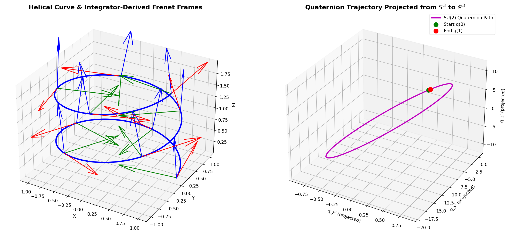

# Spectral Compression of 3D Surfaces via Quaternionic Moving Frames and the Spiral Transform

**Author:** Padraic  
**Full Manuscript:** [pdf/spectral_compression_3d_surfaces.pdf](../pdf/spectral_compression_3d_surfaces.pdf) | [LaTeX Source](main.tex)

---

## Overview

This manuscript develops a differential-geometric framework for parameterizing and spectrally compressing three-dimensional surfaces of revolution about non-planar curved axis paths. 

While classic spectral methods (such as Fourier series or spherical harmonics) excel at compressing smooth, continuous signals, they fail when applied directly to raw unstructured 3D coordinate meshes. By aligning coordinates naturally with the moving frame of a curved axis and taking the winding number to infinity, we execute a **spiral dimensional reduction** that maps 3D surfaces onto a single continuous 1D radius waveform $r(t)$. 

Because physical and organic surfaces exhibit high spatial correlation, this 1D waveform is spectrally concentrated, enabling high-fidelity 3D geometric reconstruction while discarding up to $97\%$ of Fourier modes. Furthermore, by generalizing the sampling manifold to Minkowski $L_p$ metric spaces, the framework compresses sharp geometric objects (such as boxes) without Gibbs ringing.

---

## Visual Showcase

| 3D Spiral Reconstruction (Vase) | Generalized $L_p$ Metric Spaces |
| :---: | :---: |
|  |  |
| *Original 3D vase, extracted 1D waveform $r(t)$, and 97% Fourier mode reduction reconstruction.* | *Unit circles in Minkowski $L_p$ metric spaces: diamond ($p=1$), Euclidean ($p=2$), box ($p=\infty$).* |

| Moving Frame & Quaternion Trajectory | Sharp Geometry Compression ($L_\infty$) |
| :---: | :---: |
|  |  |
| *Bishop/Frenet frame integration via unit quaternions in $\mathbb{H}$ and $\operatorname{SU}(2)$ spin operators.* | *Original sharp 3D box (left) and decompressed mesh (right) using variance-optimized $L_\infty$ norm.* |

---

## Key Mathematical Theorems

1. **Tubular Diffeomorphism Non-Degeneracy Condition (Proposition 1):**
   The coordinate map $\Phi(s, u, v) = \gamma(s) + u\mathbf{N}(s) + v\mathbf{B}(s)$ has Jacobian determinant $\det J = 1 - u\kappa(s)$. Diffeomorphism is guaranteed if and only if $\max r(s) < \min 1/\kappa(s)$.
2. **Concave Boundary Cusp Singularities:**
   Differentiating concave boundary curves $h'(s) = \mathbf{T}(s)(1 - r(s)\kappa(s))$ reveals that when the offset approaches the radius of curvature $1/\kappa(s)$, derivative vanishing generates physical cusp singularities.
3. **Density of Spiral Path (Proposition 2):**
   In the limit as winding number $n \to \infty$, the image of the spiral path $\mathbf{c}_n(t)$ is dense in the surface $\mathcal{M}$, reducing the 3D surface to a continuous 1D waveform $r(t)$.
4. **Variance Minimization of Fourier Energy (Theorem 1):**
   By Parseval's theorem, the statistical variance of a spatial signal equals the sum of squared magnitudes of non-DC Fourier coefficients:
   $$\operatorname{Var}(r) = \sum_{k=1}^{N-1} |\hat{r}[k]|^2$$
   This enables finding the optimal metric $p_{\text{opt}} = \operatorname{argmin}_{p \ge 1} \operatorname{Var}(r_p(\theta))$ directly in the spatial domain without computing the FFT.

---

## Directory Structure & Scripts

```text
spectral-compression/
├── main.tex                       # Complete LaTeX research paper
├── figures/                       # Generated high-resolution figures
└── scripts/                       # Numerical simulation & compression pipeline
    ├── spiral_compression_test.py # End-to-end 3D vase spiral transform & FFT compression
    ├── mesh_compression_test.py   # STL mesh ray-casting and Lp compression (box & head)
    ├── quaternion_frame.py        # RK4 unit quaternion integration & stereographic plot
    ├── evolute_unwrapping.py      # Evolute straightening to cylinder simulation
    ├── generate_lp_figs.py        # Lp circles and pi(p) potential well plots
    ├── symmetric_cusp.py          # 2D planar offset ribbon and cusp singularity analysis
    ├── test_pi.py                 # Numerical verification of pi(p) metric
    └── *.stl                      # 3D test meshes (Head-3, test box)
```

## Running the Verification Scripts

```bash
# Set up environment
python3 -m venv .venv
source .venv/bin/activate
pip install -r ../requirements.txt

# Run spiral compression demo
python3 scripts/spiral_compression_test.py

# Run quaternion frame integration
python3 scripts/quaternion_frame.py

# Run Lp unit circle analysis
python3 scripts/generate_lp_figs.py
```
