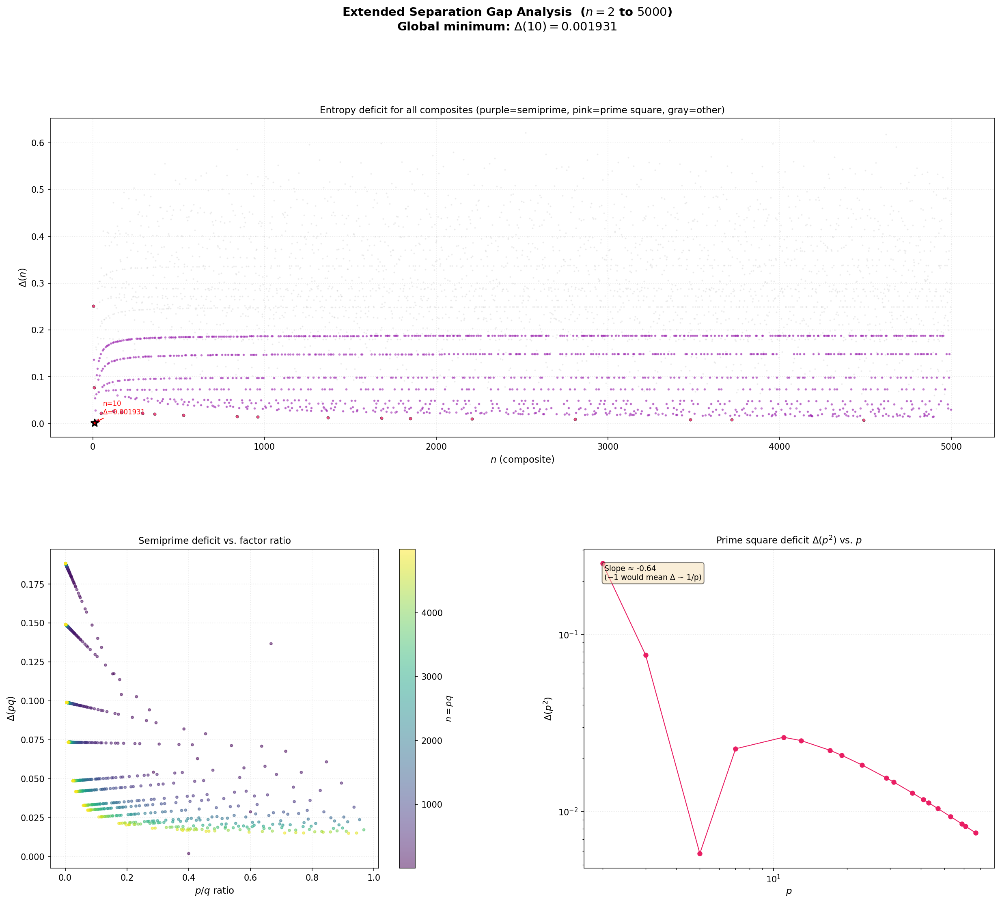
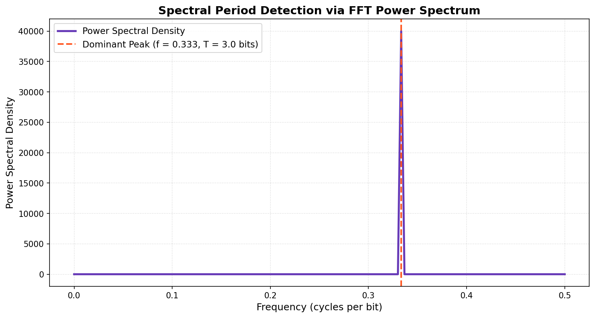

# On the Spectral Entropy, Periodicity, and Representation Limits of Discrete Sequences

**Author:** Padraic  
**Full Manuscript:** [pdf/spectral_entropy_discrete_sequences.pdf](../pdf/spectral_entropy_discrete_sequences.pdf) | [LaTeX Source](main.tex)

---

## Overview

This manuscript develops a unified mathematical and computational framework exploring the boundaries between discrete sequences, information theory, complex transforms, and continuous spectral representations across three domains:

1. **Modular Arithmetic & Finite Fields:** Proving that the Shannon entropy of flattened modular multiplication matrices achieves its theoretical maximum if and only if $n$ is prime. Introducing the **Spectral Remainder Transform** $\mathcal{S}_n(z)$, whose Cauchy residues recover remainder distributions, and constructing a continuous entropy landscape $S(x)$ that isolates prime numbers via gradient ascent.
2. **Quantum Ring Analogy & Anderson Localization:** Translating modular remainder counts into delta-potential wells on a 1D unit ring. Solving the time-independent Schrödinger equation reveals that prime rings act as resonant crystals supporting extended Bloch waves ($\text{PR} \approx 66\%$), whereas composite rings induce severe **Anderson localization** ($\text{PR} \approx 2.5\%$).
3. **Sequence Periodicity & Continuous Representation Limits:** Demonstrating that per-bit block entropy reaches a minimum at the natural word length of a sequence, extractable in $\mathcal{O}(N \log N)$ time via the Fast Fourier Transform. Establishing an **Information Conservation Law** ($M \cdot B \ge N$) proving that continuous curve embeddings cannot bypass Shannon limits due to floating-point inflation and degree-of-freedom conservation.

---

## Visual Showcase

| Quantum Ring: Bloch Waves vs. Anderson Localization | Continuous Entropy Landscape & Prime Peaks |
| :---: | :---: |
|  |  |
| *Top: Potentials $V(\theta)$ for prime $n=97$ vs. composite $n=96$. Bottom: Extended Bloch wave transport in primes vs. Anderson localization in composites.* | *Continuous signal $S(x)$ and derivative $S'(x)$ isolating all 168 primes up to 1000 via descending zero-crossings without false positives.* |

| Separation Gap & Prime-Square Decay | Block Entropy & FFT Period Detection |
| :---: | :---: |
|  |  |
| *Log-log scaling confirming prime-square deficit decay $\Delta(p^2) \sim 1/(2p)$ and linear contrast scaling $\beta \sim \mathcal{O}(N)$.* | *Power spectral density peak at $f = 0.333$ extracting fundamental period $T = 3$ in $\mathcal{O}(N \log N)$ time.* |

---

## Key Mathematical Theorems

1. **Entropy Maximization and Fields (Theorem 1):**
   The Shannon entropy of the flattened reduced modular multiplication table satisfies:
   $$H(P_n) = \log_2(n-1) \iff n \text{ is prime}$$
   Proven via row permutations in finite fields $\mathbb{F}_n$ vs. zero-divisor cycling in composite rings.
2. **Spectral Remainder Transform & Residue Identity (Definition 1, Lemma 1):**
   The meromorphic function $\mathcal{S}_n(z) = \sum_{j,k} \frac{1}{z - e^{2\pi i (jk \bmod n)/n}}$ recovers empirical remainder probabilities through its Cauchy residues at the $n$-th roots of unity:
   $$p(s) = \frac{\operatorname{Res}(\mathcal{S}_n, z_s)}{(n-1)^2}$$
3. **Laurent Coefficients Identity & Ramanujan Sums (Proposition 2, Corollary 1):**
   The expansion at infinity $\mathcal{S}_n(z) = \sum_{m=0}^\infty \frac{C_m(n)}{z^{m+1}}$ has exact coefficients:
   $$C_m(n) = n \cdot \gcd(m, n) - 2n + 1$$
   $n$ is prime if and only if $C_m(n) = 1 - n$ for all $1 \le m \le n - 1$.
4. **Prime-Square Deficit Decay (Proposition 1):**
   The entropy deficit of prime squares decays asymptotically as $\Delta(p^2) \sim \frac{1}{2p}$, necessitating linear contrast scaling $\beta \sim \mathcal{O}(N)$ in the continuous indicator function.
5. **Information Conservation Law (Theorem 3):**
   Any injective mapping from a binary sequence $\{0,1\}^N$ into $M$ real-valued parameters stored with bit-width $B$ must satisfy:
   $$M \cdot B \geq N$$
   Piecewise-linear sinusoidal encoding requires at least $K = N/4$ modes, incurring an $8\times$ inflation penalty under 32-bit floating point representations.

---

## Directory Structure & Scripts

```text
spectral-entropy/
├── main.tex                    # Complete LaTeX research paper
├── suggested_readings.txt      # Annotated literature references
├── figures/                    # Generated high-resolution plots
└── scripts/                    # Numerical simulation & validation suite
    ├── quantum_ring.py         # Quantum tight-binding lattice & Anderson localization
    ├── continuous_entropy.py   # Continuous signal S(x) evaluation through N=1000
    ├── delta_analysis_extended.py # Separation gap scale-up through N=5000 & prime-square decay
    ├── block_entropy.py        # Block entropy sweep across binary sequences
    ├── fft_period.py           # O(N log N) FFT period and phase detection
    ├── piecewise_linear_binary.py # Sinusoidal encoding & Fourier mode decay
    ├── pmatrix.py              # Modular multiplication matrix entropy tests
    └── requirements.txt        # Local dependencies
```

## Running the Verification Scripts

```bash
# Set up environment
python3 -m venv .venv
source .venv/bin/activate
pip install -r ../requirements.txt

# Run quantum tight-binding lattice simulation
python3 scripts/quantum_ring.py

# Run continuous entropy landscape and prime detection
python3 scripts/continuous_entropy.py

# Run extended separation gap analysis
python3 scripts/delta_analysis_extended.py
```
